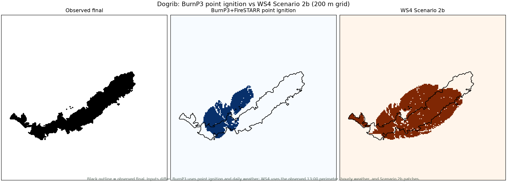

# BurnP3+FireSTARR Dogrib result

Date: 2026-11-09
Parent: #923 P157
Task: #945 P157.10
Status: point-ignition reference run complete

## What ran

- BurnP3+ 2.6.10 and BurnP3+FireSTARR 1.5.7 under SyncroSim 3.1.32.
- BurnP3+FireSTARR transformer, deterministic, one iteration, one fire.
- 200 m padded Dogrib fuel and elevation rasters.
- Point ignition at the Dogrib ignition location.
- One 23-hour burn day with constant daily weather; FireSTARR generated the hourly weather stream from the BurnP3 daily condition.
- The SyncroSim result-scenario assembly failed after model execution, so the same BurnP3-generated FireSTARR inputs and command were rerun with occurrence output to recover the footprint.

This is a BurnP3+FireSTARR **point-ignition** run. It is not a Scenario 2b reproduction:
BurnP3+FireSTARR does not accept the observed 13:00 start perimeter, the fuel break, or
the river-polygon wind patch.

## Result

| Model | Area (ha) | Area bias | Perimeter bias | Centroid | IoU | Sorensen | Orientation |
| --- | ---: | ---: | ---: | ---: | ---: | ---: | ---: |
| Observed final | 10,132 | — | — | — | — | — | — |
| BurnP3+FireSTARR | 6,004 | −40.7% | −24.5% | 6.44 km | 0.103 | 0.187 | 17.1° |
| WS4 Scenario 2b | 16,241 | +58.9% | +75.9% | 1.77 km | 0.385 | 0.556 | 6.5° |
| WS4 raw wind | 29,480 | +191.0% | +157.1% | 3.09 km | 0.252 | 0.403 | 9.1° |

The BurnP3 point-ignition run is closer in area than WS4 raw wind but underburns and has
much lower overlap. WS4 Scenario 2b has much better overlap and centroid error, but it
uses the observed start perimeter and hourly Scenario 2b patches, so the comparison is
not apples-to-apples.

## Interpretation

- BurnP3+FireSTARR is usable as a CFS FireSTARR reference at point ignition.
- It cannot test the Scenario 2b start-perimeter/fuel-break/patch hypothesis.
- BurnP3+Prometheus is still the required route for a Scenario 2b comparison, and
  Prometheus remains blocked under Wine.
- Do not rank the models from this table. The input bases differ.

## View

## Artifacts

- `notes/reports/p157-burnp3-dogrib.csv`
- `notes/reports/p157-burnp3-comparison.png`
