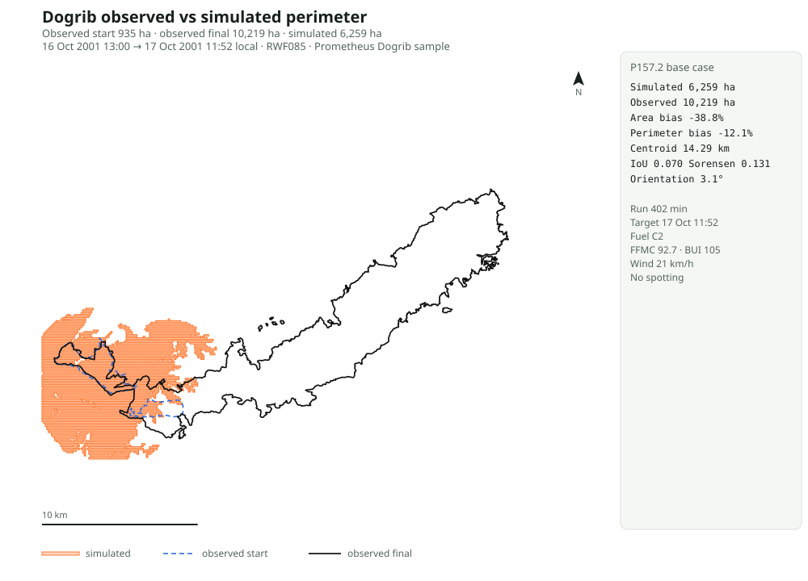

# P157.2 observed-perimeter comparison: Dogrib fire

Date: 2026-11-08
Branch: `feature/p157-observed-fire`
Task: P157.2 (#926)
Parent: P157 (#923)

## Question

Can the P156 growth engine reproduce the observed Dogrib fire perimeter when it is started
from the observed 13:00 perimeter and run through the 6.7-hour wind event?

## Inputs

- Fire: Dogrib (RWF085), Alberta, 2001.
- Start: observed 2001-10-16 13:00 perimeter, 935 ha across 2 polygons.
- Target: observed 2001-10-17 11:52 perimeter, 10,219 ha across 25 polygons, including spot
  fires.
- Grid: 357 × 223 cells at 100 m; custom NAD83 Transverse Mercator.
- Fuel: homogeneous C2 approximation over cells with a burnable observed fuel type.
- Weather: FFMC 92.7 and BUI 105.0 derived from the event weather stream with the Prometheus
  starting DMC 64 and DC 535; wind 21.0 km/h from 267.6°.
- Terrain: homogeneous 32% slope, 180° aspect.
- Duration: 402 minutes (6.7 hours).
- Ignition: every burnable cell inside the observed start perimeter (759 cells).

The run is a base case, not a calibrated case. Fuel, slope, and weather are homogeneous
approximations of a heterogeneous fire.

## Time alignment

The run is 402 minutes, from 13:00 to about 19:42 local. The only final observed perimeter
is at 11:52 the next day, 1,372 minutes after the start. The comparison is therefore **not
time-matched**: a 6.7-hour simulation is scored against a 23-hour observed final. The
observed final also contains later growth and spot fires. The 800-minute sensitivity is still
not time-matched. This makes the area, centroid, and overlap results a joint test of model
and time mismatch, not a clean 6.7-hour test.

## Base-case metrics

| Metric | Value |
| --- | --- |
| Simulated area | 6,259 ha |
| Observed area | 10,219 ha |
| Area bias | −38.8% |
| Simulated raster perimeter | 140.8 km |
| Observed raster perimeter | 160.2 km |
| Perimeter bias | −12.1% |
| Centroid distance | 14.29 km |
| IoU | 0.070 |
| Sorensen | 0.131 |
| Orientation error | 3.1° |
| Head ROS | 39.9 m/min |
| Length-to-breadth | 3.26 |
| Effective wind | 25.5 km/h at 55.5° |

## View



The SVG is generated by `scripts/benchmark_observed_fire.py` and served read-only at
`/api/fire/observed/dogrib.svg`. Orange is the simulated burned mask; dashed blue is the
observed 13:00 start; black is the observed final perimeter. The right panel carries the time,
inputs, and metric summary. The observed geometry is read-only.

## Screening tolerances

These are screening tolerances for the first observed case, not operational acceptance.

| Check | Tolerance | Base case | Result |
| --- | --- | --- | --- |
| Area bias | ±50% | −38.8% | pass |
| Perimeter bias | ±35% | −12.1% | pass |
| Orientation error | ≤30° | 3.1° | pass |
| Centroid distance | ≤5 km | 14.29 km | fail |
| IoU | ≥0.30 | 0.070 | fail |
| Sorensen | ≥0.45 | 0.131 | fail |

The base case does **not** capture the observed footprint. The 3.1° value is only agreement
between the principal axes of the two burned-pixel sets; it is not directional or shape
agreement. The −12.1% value compares raster perimeters, not shapes. A compact blob can have a
similar raster perimeter to a long, narrow run. The meaningful checks fail: area is 38.8% low,
the centroid is 14.29 km away, and IoU is 0.070. That is the central result of this validation,
not a hidden calibration target.

## Sensitivity set

The script also runs four explicit overrides and one longer run. All use the same start
perimeter and fuel approximation.

| Scenario | Area (ha) | Area bias | Perimeter bias | Centroid (km) | IoU | Sorensen | Orientation error |
| --- | --- | --- | --- | --- | --- | --- | --- |
| base | 6,259 | −38.8% | −12.1% | 14.29 | 0.070 | 0.131 | 3.1° |
| wind 27 km/h | 6,149 | −39.8% | −13.0% | 14.10 | 0.071 | 0.132 | 2.2° |
| wind 43 km/h | 5,865 | −42.6% | −15.6% | 13.77 | 0.072 | 0.135 | 0.6° |
| flat slope | 6,675 | −34.7% | +5.1% | 13.42 | 0.068 | 0.128 | 9.7° |
| no wind | 6,018 | −41.1% | −23.7% | 15.01 | 0.071 | 0.133 | 82.7° |
| 800 minutes | 8,369 | −18.1% | +31.2% | 13.69 | 0.062 | 0.117 | 22.7° |

More wind does not increase the simulated area because the fire is already constrained by the
burnable mask and the homogeneous fuel; more time increases area but also overpredicts the
perimeter and does not improve overlap. Removing wind changes the orientation, as expected.

## What this verifies

- The observed-fire contract and the Dogrib fixture load reproducibly.
- The 402-minute run starts from the observed perimeter and is deterministic.
- The comparison harness computes area, perimeter, centroid, IoU, Sorensen, and orientation.
- The base case passes only the loose area/perimeter/orientation screen. That screen is not a
  validation pass, and the footprint checks fail.
- The base case fails the centroid and overlap screen, and the sensitivity set does not rescue
  it.

## What this does not verify

- Heterogeneous fuel and terrain. The run uses one FBP fuel type and one slope/aspect.
- Spotting and firebrand transport. The observed final perimeter contains 25 polygons; the
  model has no spotting.
- Dynamic weather. The run uses one representative weather state rather than the hourly
  stream.
- An operational forecast. This is a single historical case, not a regional calibration.

## Reproduction

```bash
python scripts/benchmark_observed_fire.py
```

Artifacts:

- `notes/reports/p157-dogrib-results.csv`
- `notes/reports/p157-dogrib-summary.json`

## Recommendation

Keep the base-case metrics as the observed-fire characterization. P157.3 can display the
observed and simulated perimeters together; P157.2 does not claim a passing footprint match.
A heterogeneous-fuel/terrain run and a spotting layer are the next modelling steps if the
centroid and overlap failures are to be addressed.
