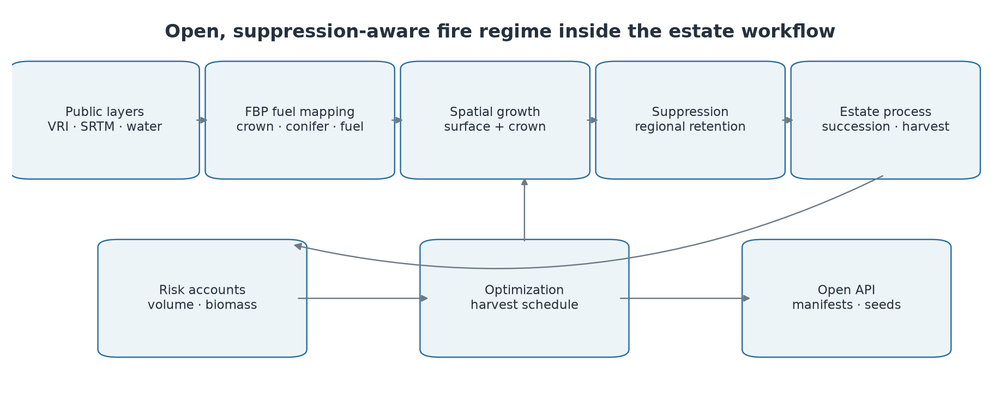
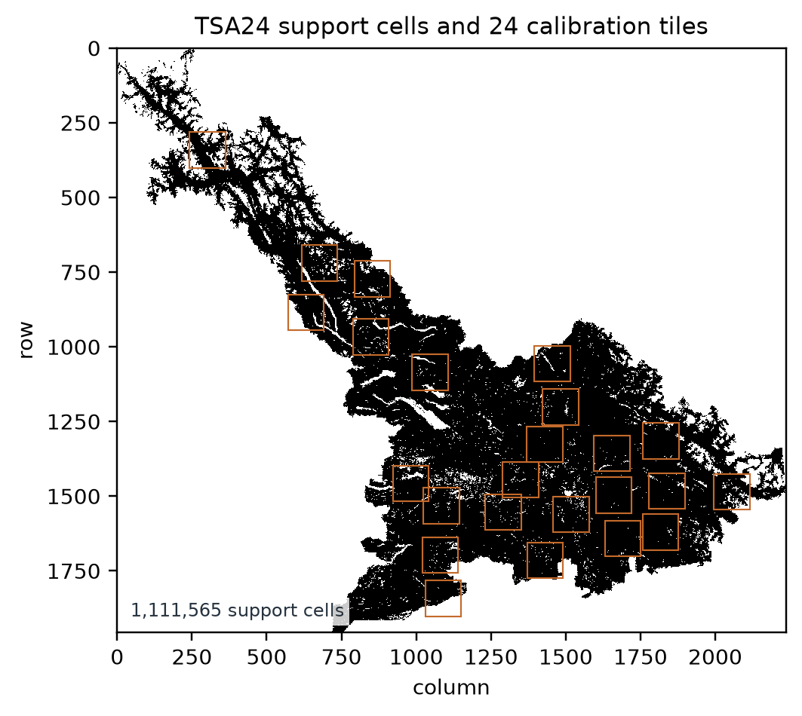
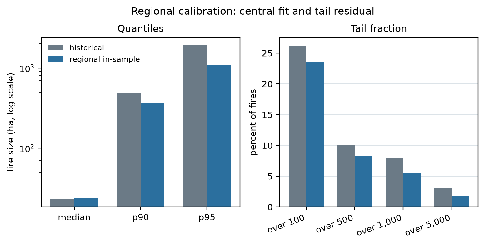
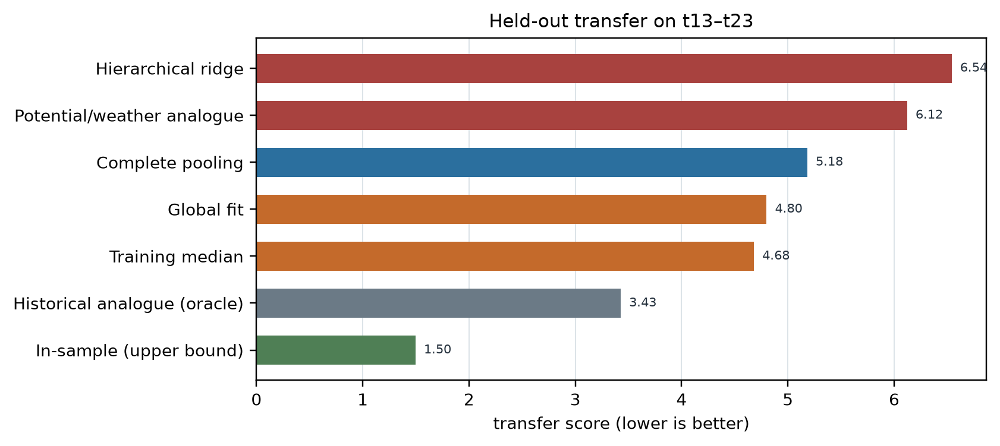
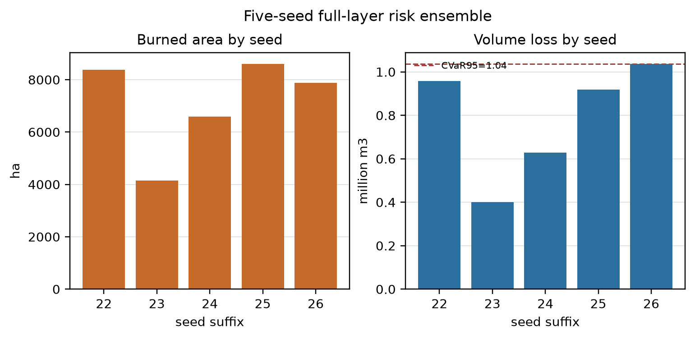
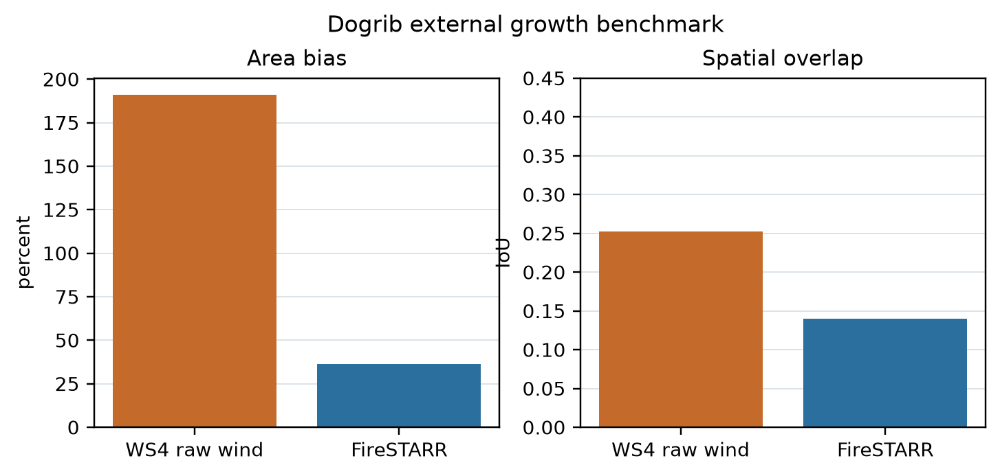

> **HISTORICAL DRAFT.** The canonical manuscript is in `fresh_ws4_fire_regime_manuscript`. This draft predates the canonical support-map replacement.

# An open, suppression-aware fire regime for forest estate optimization: integration, calibration, and transfer diagnostics

**Draft manuscript for internal review — not submitted**

LaTeX source: `https://github.com/UBC-FRESH/fresh_ws4_fire_regime_manuscript`

Authors: [to be completed]

Affiliations: [to be completed]

Corresponding author: [to be completed]

## Highlights

- We couple Canadian FBP fire behaviour, spatial growth, reduced-form suppression, succession, estate accounting, and optimization in one open workflow.
- The case study covers 458,708 TSA24 blocks and 1,111,565 support cells at 250 m.
- A global suppression fit failed pre-registered gates; a 23-region in-sample map reproduced the central fire-size distribution but underproduced the tail.
- Independent transfer to held-out tiles was negative; a hierarchical ridge did not recover regional skill with potential/weather covariates.
- A five-seed risk ensemble and a 36-worker sharded estate optimization demonstrate the computational path.

## Abstract

Wildfire is a spatial, stochastic disturbance that is rarely represented as an endogenous process in open forest estate planning. We present an open, reproducible coupling of Canadian Forest Fire Behaviour Prediction (FBP) surface and crown fire behaviour, spatially explicit fire growth, reduced-form regional suppression and escape, LANDIS succession, estate accounting, and spatially explicit optimization. The implementation operates on a compiled TSA24 dataset with 458,708 blocks and 1,111,565 support cells at 250 m, with a 133-tile VRI/SRTM/water layer cache.

A global suppression calibration under a pre-registered protocol failed its training gates. A 23-region in-sample calibration reproduced the median fire size (23.8 ha versus 23.0 ha historical) and the maximum (20,770.4 ha versus 25,114.8 ha), but remained low in the upper tail (p90 361.5 ha versus 490.2 ha). Independent transfer to 11 held-out tiles was negative: the in-sample score was 1.50, compared with 6.12 for a deployable potential/weather analogue and 4.80 for the global fit. An empirical-Bayes ridge selected by training-only cross-validation also failed on held-out tiles (6.54) and did not outperform complete pooling (5.18).

A five-seed full-layer risk ensemble produced a median burned area of 7,889.6 ha and a CVaR95 volume loss of 1.04 million m3 against a no-fire baseline of 822.55 million m3. A five-year full-estate evaluation burned 8,374.1 ha and harvested 156,358.8 ha. A 36-worker sharded optimizer produced a 179-event schedule and a full-estate evaluation in 655.5 s. On a documented Dogrib fire, the growth engine overpredicted area by 191% versus 36% for FireSTARR, but had higher overlap (IoU 0.252 versus 0.140); neither result is an operational validation.

The contribution is an auditable open integration and a documented calibration/transfer diagnosis, not a validated operational fire forecast or a new fire-physics formulation. The results show both the practical value and the current limits of open, process-based fire risk in forest estate planning.

**Keywords:** wildfire risk; forest estate optimization; FBP System; suppression; open-source software; reproducibility; TSA24

## 1. Introduction

Wildfire is a landscape process, but many forest planning systems treat fire loss as an exogenous
parameter or a static burn-probability overlay. That separation is increasingly difficult to
justify. Harvesting, road construction, regeneration, and silviculture alter fuel structure and
landscape connectivity, which in turn alter fire behaviour and the value at risk (Acuna et al.
2010). At the same time, suppression and fire management alter the size distribution of fires and
the conditions under which planning assumptions remain valid (Duff and Tolhurst 2015; Finney et al.
2011).

Operational fire modelling already has sophisticated components. FSim simulates large-fire
occurrence, growth, behaviour, and containment over many synthetic fire seasons (Finney et al.
2011). Burn-P3 and BurnP3+ use Canadian FBP growth and Monte Carlo simulation for burn probability
and risk (Parisien et al. 2005, 2019; BurnP3+ documentation). Cell2Fire is an open-source,
parallel, FBP-based growth model designed for strategic landscape planning (Pais et al. 2021), and
its Mediterranean adaptation has been developed for tactical forest planning (Gonzalez-Olabarria
et al. 2023). LANDIS-II provides an open, process-based fire regime coupled to succession
(Sturtevant et al. 2009). Integrated fire-forest management studies have also demonstrated the
concept of endogenous fire risk in harvest scheduling (Acuna et al. 2010; Ager et al. 2020;
Labarre et al. 2026).

The gap is therefore not the absence of fire modelling, or even the absence of fire-forest
integration. The gap is an **open, auditable, end-to-end workflow** that connects public forest and
terrain data to a process-based fire regime, regionally calibrated suppression and escape, a
spatially explicit estate process, and optimization, with the code, inputs, seeds, and residuals
available for inspection. Much of the existing integration is bespoke, proprietary, or tied to a
particular institutional data stack. Open-source fire models and open-source estate models exist,
but the complete chain is still uncommon.

We address that gap with the WS4 fire and ecosystem layer, developed alongside the open WS3 forest
estate framework (Paradis 2026). Our objectives are to:

1. describe an open architecture that links FBP fire behaviour, spatial growth, reduced-form
   suppression/escape, succession, estate accounting, and optimization;
2. document a pre-registered regional calibration and its residuals, including failure;
3. test whether the calibrated suppression map transfers to held-out tiles;
4. demonstrate full-estate risk and optimization runs and their computational cost;
5. provide a reproducibility package that another group can inspect and rerun.

We do not claim a new fire-spread model, a new suppression-resource model, or a validated
operational forecast. The scientific contribution is the integration, the calibration protocol,
and the transfer diagnosis.

**Table 1. Positioning of this work against representative fire and estate systems.**

| Capability | FSim | BurnP3+ | Cell2Fire | LANDIS-II | Integrated fire-estate studies | This work |
| --- | --- | --- | --- | --- | --- | --- |
| Canadian FBP behaviour | no | yes | yes | partial | yes | yes |
| Spatially explicit growth | yes | yes | yes | yes | yes | yes |
| Suppression/containment | yes | partial | no | partial | yes, case-specific | reduced-form regional |
| Forest estate optimization | no | no | partial/static | no | yes | process-coupled, sharded |
| Open-source code | not a general open package | yes | yes | yes | no | yes |
| Open data end-to-end | no | partial | no | no | no | yes, public BC data |
| Full-estate BC case | no | no | no | no | no | yes |

The table is qualitative and cites the systems introduced above; “partial” means the capability is
not the central published contract or is not exposed as a reusable open path.

## 2. Methods

### 2.1 Study area and data

The case study is TSA24 in British Columbia, Canada. The compiled dataset contains 458,708 blocks.
The area-weighted support grid has 1,957 by 2,237 cells at 250 m, representing 1,111,565 support
cells. A 133-tile layer cache covers every support cell; 1,012,231 support cells are forested.

Inputs were:

- BC Vegetation Resources Inventory (VRI) polygons for fuel, crown closure, conifer fraction, and
  land-cover class;
- VRI non-vegetated polygons for water and wet edges;
- SRTM 1 arc-second elevation, with slope and aspect derived at 250 m;
- historical BC Wildfire perimeters and incident records for calibration and comparison;
- Open-Meteo historical weather for the 2023 fire season and 90-day antecedent spin-up;
- the public TSA24 compiled inventory and block geometry used by the project.

The analysis is deliberately explicit about data provenance. Large caches are not stored in Git;
they are described by a manifest with tile bounds and SHA-256 hashes. Licensing for VRI, weather,
and perimeter products must be confirmed before redistribution.

### 2.2 Fire behaviour and growth

The fire-behaviour layer implements the Canadian FBP surface and crown equations. The surface
rate of spread, crown fraction burned, and crown rate of spread follow the FBP formulations. The
growth engine converts the head rate of spread into an elliptical perimeter and propagates
arrivals across a raster with a direction-dependent rate of spread. Slope is folded into the wind
vector using the FBP slope adjustment. Weather is supplied as FWI codes and wind; the model
supports time-varying weather steps, although the case study uses a fixed weather state for the
calibration simulations.

The model uses a 250 m grid, a 10-hour active spread day, and a 90-day antecedent weather spin-up
for tail-event sampling. An optional screening spotting model exists but is off by default and is
not used for the operational claims in this paper. The fire-growth model is not a coupled
fire-atmosphere model and does not represent ember transport, fireline construction, or
firefighter tactics.

### 2.2.1 External growth benchmark

We also compare the growth engine with FireSTARR on the documented Dogrib fire (RWF085, Alberta,
2001), using the project's observed-fire benchmark. WS4 raw wind and FireSTARR v0.9.29
deterministic were run on the same 200 m grid with the observed start perimeter, fuels, terrain,
and weather. No Scenario 2b polygon wind patch was applied to either model. This is a
growth-model comparison on one historical fire, not a TSA24 calibration benchmark and not an
operational validation.

### 2.3 Reduced-form suppression and escape

Suppression is represented as a two-stage retention process applied to a potential fire size.
First, a contained fraction draws the size retained after containment. If the fire escapes, an
escaped fraction draws the retained size, subject to an absolute escape cap. Escape probability is
a logistic function of active duration, FWI, BUI, wind, and a regional intercept. The six fitted
parameters are:

- contained fraction median and log-sigma;
- escaped fraction median and log-sigma;
- escape cap in hectares;
- escape hazard intercept.

This is a reduced-form suppression/escape layer. It does not allocate crews, aircraft, or
firelines, and it should not be interpreted as an operational suppression model. It is designed to
represent the aggregate effect of suppression on the fire-size distribution at the landscape scale.

### 2.4 Global and regional calibration

Potential fires were sampled at 30 per tile, 720 in total. Each potential fire was grown with the
real VRI/SRTM/water layers, 10 active hours per day, and a 90-day antecedent weather sample. A
global calibration searched 1,500 pre-registered parameter candidates and selected the best
training-only candidate. The pre-registered gates covered median, p90, over-100, over-500,
over-1,000, over-5,000, and maximum fire size.

The global training fit failed the maximum and over-5,000 gates, so the protocol returned a no-go.
We therefore fitted one parameter set per 30 km tile (regional calibration), using 1,000
pre-registered candidates per tile and the same potential sample. The regional objective was a
weighted distance over the 10th, 25th, 50th, 75th, 90th, and 95th percentiles plus the over-500,
over-1,000, and over-5,000 fractions. The regional fit used every tile with at least five
historical fires; the tile without a historical sample uses the median default in the applied map.
No global pass/fail gate is applied to the regional map.

### 2.5 Independent transfer tests

The fixed split was `t01`–`t12` for training and `t13`–`t23` for validation; `t24` has no
historical perimeter sample and is excluded. Parameters were frozen before validation. Five
deterministic suppression draws were made per potential fire, giving 150 simulated fires per tile.

We compared five methods:

1. **In-sample regional fit** — each tile's own fitted parameters; an upper bound, not a transfer
   test.
2. **Global fit** — the best training-only global candidate.
3. **Training median** — the median of the 12 training tile parameter sets.
4. **Potential/weather analogue** — the nearest training tile by log potential median, log
   potential p90, log potential mean, mean FWI, mean BUI, mean wind, and mean active days.
5. **Historical analogue** — nearest training tile by historical fire-size metrics; an oracle
   diagnostic, not a deployable method.

The transfer score was a normalized distance to the tile's historical metrics:

- absolute log ratio for median, p90, p95, and maximum;
- absolute difference for over-500, over-1,000, and over-5,000 fractions;
- weights 3 for over-500 and over-1,000, 2 for over-5,000, and 0.5 for maximum.

A separate hierarchical test used an empirical-Bayes ridge regression for the six parameters. The
positive parameters were modelled on a log scale and the intercept on its natural scale. The
predictors were the same potential/weather features. Shrinkage was selected by leave-one-tile-out
on the training split using the actual suppression simulation score, not parameter-space error.
Predictions were clipped to the pre-registered P164.8 bounds and evaluated once on the validation
tiles.

### 2.6 Estate process and optimization

The compiled dataset is the estate contract. `ProcessDataset` loads fragments, blocks, tracks,
curves, and treatment windows. The process engine applies management, fire, LANDIS succession,
salvage, and regeneration to a cohort state. The fire source is the calibrated relative-growth
source: it emits fire events for the fragments reached by each growth run, and the process engine
applies mortality to the cohorts.

The full-estate support map is an area-weighted `FragmentSupport` grid. This preserves all
458,708 blocks without expanding the matrix to one raster cell per fragment, and it allows the
same compiled matrix to serve multiple block layouts.

The five-year estate case used a fixed TSA24 harvest schedule with 12,176 block entries. It
evaluated the full dataset with the calibrated fire source over five years. The risk ensemble
repeated the same schedule under five fire seeds. The sharded optimizer divided the estate into
133 30 km tiles, selected up to the 20 largest eligible CC blocks per tile, and ran two local
hill-climb rounds with a 10% local harvest target. The shard schedules were aggregated and
evaluated once on the full estate.

The sharded optimizer is a bounded decomposition heuristic. It is not a global joint optimum and
does not reconcile targets across tiles. It is reported to show that the process-coupled fire
path can run at estate scale, not to claim a globally optimal plan.

### 2.7 Reproducibility

All stochastic runs record their seeds. The full-layer manifest records tile bounds and hashes.
The compact result JSON/CSV artifacts are tracked; the 90 MB layer cache and 882 MB DEM cache are
local and described by a reproducibility manifest. The reusable API is
`ws4.ecosystem.build_estate_fire_source`, which loads the layer stack and region map and builds the
fire source from a support grid and ignition schedule.

The analysis used 36-worker runs on a Linux workstation. The full dataset load was 139 s, the
five-year fire-source build was 1,070 s, and the full-estate optimizer took 655.5 s.

## 3. Results

### 3.1 Layer coverage

The 133 aligned tiles covered all 1,111,565 support cells (100%). The cache contains 90,375,672
bytes of layer data and a 133-entry manifest. The DEM cache contains 34 SRTM tiles and 881,769,668
bytes. Every support cell has a fuel/forest/terrain record; non-forest support cells remain
non-burnable.

### 3.2 Calibration

The global P164.8 candidate failed the training maximum and over-5,000 gates, so the protocol
returned a no-go. The regional in-sample map is summarized in Table 2.

**Table 2. Regional calibration residuals.**

| Metric | Historical | Regional in-sample |
| --- | ---: | ---: |
| Fires | 432 | 3,450 |
| Median | 23.0 ha | 23.8 ha |
| p90 | 490.2 ha | 361.5 ha |
| p95 | 1,918.9 ha | 1,100.9 ha |
| Over 100 ha | 26.2% | 23.6% |
| Over 500 ha | 10.0% | 8.3% |
| Over 1,000 ha | 7.9% | 5.5% |
| Over 5,000 ha | 3.0% | 1.8% |
| Maximum | 25,114.8 ha | 20,770.4 ha |

The central distribution and maximum are close. The upper-middle and extreme-tail fractions remain
low. This is an in-sample fit, not an independent validation.

### 3.3 Transfer and hierarchical validation

The independent transfer result is shown in Table 3.

**Table 3. Held-out transfer on `t13`–`t23`.**

| Method | Mean score | Median score |
| --- | ---: | ---: |
| In-sample upper bound | **1.495** | **1.478** |
| Historical analogue, oracle | 3.426 | 3.486 |
| Training median | 4.680 | 5.088 |
| Global fit | 4.799 | 3.948 |
| Potential/weather analogue | 6.121 | 5.944 |

The deployable potential/weather analogue performed worse than the global fit and the training
median. The oracle historical analogue also remained well above the in-sample score. The nearest
potential donor was usually `t03` or `t04`, indicating that the available potential and weather
features did not distinguish the suppression regimes.

The hierarchical ridge selected lambda 100 by training-only simulation score. Its held-out score
was 6.540, compared with 5.182 for complete pooling and 5.287 for the global fit in that run. The
partial-pooling covariates did not recover transferable skill.

### 3.4 Risk ensemble

The five-seed full-layer risk ensemble produced:

**Table 4. Five-seed risk ensemble.**

| Metric | Value |
| --- | ---: |
| Burned-area median | 7,889.6 ha |
| Burned-area p90 | 8,600.8 ha |
| Burned-area maximum | 8,600.8 ha |
| No-fire baseline volume | 822.55 million m3 |
| Volume-loss median | 0.92 million m3 |
| Volume-loss range | 0.40–1.04 million m3 |
| CVaR95 volume loss | 1.04 million m3 |

With five seeds, the CVaR95 estimate is the worst observed seed. The result is a small-tail sample,
not a stable operational risk estimate.

### 3.5 Full-estate cases

The five-year full-layer case produced 885 fragment-level fire events, 8,374.1 ha burned,
156,358.8 ha harvested, 821.6 million m3 final volume, and 463.8 million t final biomass. The
full dataset load was 139.0 s and the schedule evaluation was 42.2 s.

The sharded optimizer covered 112 of 133 tiles; 21 tiles had no local eligible CC block in the
five-year window. It scheduled 179 blocks/events, harvested 20,775.6 ha, produced 859.98 million
m3, burned 74.25 ha in 16 fragment-level events, and finished in 655.5 s with 36 workers. These
results demonstrate the computational path, not a global optimum.

### 3.6 External growth benchmark

The Dogrib comparison is a deliberately narrow external check on the growth engine, not a
validation of the TSA24 calibration. On the common 200 m grid, WS4 raw wind and FireSTARR
overpredicted the observed final area by different margins and had different spatial skill
(Table 5).

**Table 5. External Dogrib growth benchmark.**

| Model | Area (ha) | Area bias | IoU | Sorensen | Centroid error (km) |
| --- | ---: | ---: | ---: | ---: | ---: |
| Observed final | 10,132 | — | 1.000 | 1.000 | 0.00 |
| WS4 raw wind | 29,480 | +191.0% | 0.252 | 0.403 | 3.09 |
| FireSTARR deterministic | 13,808 | +36.3% | 0.140 | 0.246 | 6.91 |

FireSTARR was closer on total area; WS4 was closer on overlap and centroid. The models fail
differently. The comparison does not include the Scenario 2b wind patch and is not an
apples-to-apples test of the calibrated TSA24 regime. It supports the narrower claim that the
growth engine is in the same order of magnitude as an external FBP implementation on a documented
fire, while making different spatial errors.

### 3.7 Runtime

The full-layer cache build used 36 workers and completed 133 tiles without missing outputs. The
five-seed source build was the dominant cost at roughly 19 minutes of wall time; the full dataset
load was 139 s and the five-year evaluation was 42 s. The sharded optimizer spent 655.5 s on 112
tiles.

## 4. Discussion

### 4.1 What is new, and what is not

The fire-physics components are established. FBP surface and crown equations, Rothermel surface
fire, FWI, and elliptical growth all have prior literature. Suppression/containment and
burn-probability models already exist (Finney et al. 2011; Parisien et al. 2019; Duff and Tolhurst
2015). Integrated fire-estate optimization also exists (Acuna et al. 2010; Ager et al. 2020;
Labarre et al. 2026).

The contribution here is the open, auditable chain: public layers to FBP fuel mapping, spatial
growth, reduced-form regional suppression, succession, estate accounts, risk, and optimization,
with a compact reproducibility package. The WS3 framework provides the open estate planning base
(Paradis 2026); WS4 provides the process-based fire/ecosystem layer. The combination is relevant
to groups that value inspectable code, open inputs, and rerunnable results, but it is not a new
theory of fire behaviour.

### 4.2 The calibration-transfer result is the main scientific signal

The regional in-sample fit is close in the centre but low in the tail. The independent transfer
test is more important: the in-sample score of 1.495 is far below the deployable potential/weather
analogue (6.121), and the oracle historical analogue (3.426) is still substantially worse than the
in-sample fit. The hierarchical ridge selected by training-only simulation score also failed
(6.540) and did not beat complete pooling (5.182).

This means the regional parameters are a description of the calibration data, not a transferable
prediction. Potential growth and weather alone do not identify a suppression regime. The next model
needs explicit suppression-capacity covariates: response time, access, crew and aircraft
availability, management policy, and multi-year weather. It also needs a hierarchical structure
that separates process variation from parameter uncertainty.

The result is useful precisely because it is negative. It shows that open calibration can expose
overfitting that a residual table alone would hide.

### 4.3 Implications for estate planning

The full-estate cases show that process-based fire risk can be run at TSA scale on a modest Linux
workstation. They do not show that the resulting schedule is optimal or that the risk estimates are
operationally calibrated. Planners should use the current outputs as scenario evidence and
sensitivity tools, not as a forecast of expected loss.

The sharded optimizer is practical but not a substitute for a global optimization. Local harvest
targets can produce a feasible schedule, but they do not reconcile volume flow, adjacency, or risk
targets across tiles. A production planning system needs a global target layer or a formal
decomposition with quality bounds.

### 4.4 Limitations

- One 2023 weather season; no multi-year weather sequence in the calibration sample.
- One 250 m grid and one fuel-mapping path; no sub-cell geometry.
- Reduced-form suppression, not resource deployment.
- In-sample regional calibration; negative independent transfer.
- Five-seed risk tail; CVaR95 is the worst observed seed.
- The external benchmark is one Dogrib fire, not the TSA24 calibration landscape; FSim, BurnP3+, and Cell2Fire comparisons on TSA24 remain future work.
- Sharded optimization with local targets; no global optimum.
- VRI, weather, and perimeter licences must be checked before data redistribution.
- No carbon or treatment-effect analysis in this paper.

### 4.5 Future work

1. Extend the external benchmark to the TSA24 landscape and to FSim, BurnP3+, or Cell2Fire,
   including fire-size and burn-probability distributions.
2. Add suppression-capacity, access, response, and management covariates to a hierarchical model.
3. Extend the calibration to multi-year weather and observed active-spread durations.
4. Replace the sharded local targets with a global coordination layer and report solution quality.
5. Publish the layer cache, calibration, and reproducibility package with a DOI and clear licences.
6. Evaluate fuel-treatment and harvest scenarios against a fire-blind baseline and a
   burn-probability overlay.

## 5. Conclusions

We presented an open, reproducible integration of FBP fire behaviour, spatial growth, reduced-form
suppression and escape, LANDIS succession, estate accounting, and optimization on a full TSA24
dataset. The implementation covers 458,708 blocks and 1,111,565 support cells, runs five-seed risk
ensembles and full-estate evaluations, and produces a sharded optimizer schedule in minutes on 36
workers.

The regional suppression calibration reproduces the central historical fire-size distribution but
not the upper tail. Independent transfer to held-out tiles is negative, and a hierarchical ridge
with potential/weather covariates does not improve it. The current calibrated region map is an
in-sample description, not a validated predictive model.

The broader contribution is methodological: an open workflow that makes the integration, residuals,
seeds, and failure modes inspectable. That is a necessary step before any operational claim, and it
is directly useful for transparent forest estate planning under wildfire risk.

## Figures

**Figure 1.** Workflow: public VRI/SRTM/water data, FBP fuel mapping, spatial growth, reduced-form
suppression/escape, LANDIS succession, estate process, risk accounts, and optimization.

**Figure 2.** TSA24 support coverage: 1,111,565 support cells and the 24 tile calibration frame.

**Figure 3.** Regional calibration residuals for the central quantiles and the upper tail.

**Figure 4.** Held-out transfer scores for the in-sample upper bound, global fit, training median,
potential/weather analogue, oracle historical analogue, complete pooling, and hierarchical ridge.

**Figure 5.** Five-seed burned-area and volume-loss distributions. The dashed line is CVaR95.

**Figure 6.** Dogrib external growth benchmark: area bias and spatial overlap for WS4 raw wind and
FireSTARR. This is not a TSA24 calibration benchmark.

## Data and code availability

The reusable estate fire API is in `ws4/ecosystem/estate_fire.py` and is exported from
`ws4.ecosystem`. The WS4 package is Apache-2.0. The analysis scripts and large layer/DEM caches are
local under `work/fire_regime/`; the layer manifest and compact result artifacts are tracked. A
reproducibility manifest records commit, versions, seeds, sizes, and SHA-256 hashes.

The layer cache and DEM cache are not redistributed in Git. Before public release, the authors must
confirm the redistribution terms for VRI, SRTM, Open-Meteo, and BC Wildfire products and archive
the caches with a DOI. The external Dogrib comparison is documented in
`notes/reports/p157-firestarr-comparison.md` and uses the public Prometheus sample data.

Licence summary: BC VRI and BC Wildfire perimeter/incident data are published under the Open
Government Licence - British Columbia; SRTM is public-domain NASA data with a requested citation;
Open-Meteo data are CC BY 4.0. The Dogrib sample has no explicit licence file in the local archive,
so raw Dogrib data are not redistributed; only the derived benchmark metrics are reported. The
full audit is `notes/reports/p164-8-data-licenses.md`.

## Author contributions

[to be completed]

## Competing interests

The authors declare no competing interests.

## Acknowledgements

[to be completed]

## References

Acuna, M. A., Palma, C. D., Cui, W., Martell, D. L., and Weintraub, A. (2010). Integrated spatial
fire and forest management planning. *Canadian Journal of Forest Research* 40, 2370-2383.
https://doi.org/10.1139/X10-151

Ager, A. A., Barros, A. M. G., Houtman, R., Seli, R., and Day, M. A. (2020). Modelling the effect
of accelerated forest management on long-term wildfire activity. *Ecological Modelling* 421,
108962. https://doi.org/10.1016/j.ecolmodel.2020.108962

BurnP3+ documentation. https://burnp3.github.io/BurnP3Plus

FireSTARR. Open-source wildfire growth model. https://github.com/CWFMF/firestarr-cpp

Duff, T. J., and Tolhurst, K. G. (2015). Operational wildfire suppression modelling: a review.
*International Journal of Wildland Fire* 24, 735-748. https://doi.org/10.1071/WF15018

Dunn, C. W., Schultz, D. T., and Musser, J. M. (2026). Designing reproducible
large-language-model-assisted scientific analyses. *Patterns* 7, 101644.
https://doi.org/10.1016/j.patter.2026.101644

Finney, M. A., McHugh, C. W., Grenfell, I. C., Riley, K. L., and Short, K. C. (2011). A simulation
of probabilistic wildfire risk components for the continental United States. *Stochastic
Environmental Research and Risk Assessment* 25, 973-1000.
https://doi.org/10.1007/s00477-011-0462-z

Forestry Canada Fire Danger Group (1992). Development and structure of the Canadian Forest Fire
Behavior Prediction System. Information Report ST-X-3. Forestry Canada, Ottawa.

Galván Lara, K. M., Miquelajauregui, Y., Enriquez Ocaña, L. F., Meling-López, A. E., and Neger, C.
(2026). Machine learning and deep learning for wildfire prediction: a systematic and bibliometric
review of methods, data practices, and reproducibility (2020-2025). *Fire* 9, 204.
https://doi.org/10.3390/fire9050204

Gonzalez-Olabarria, J. R., Carrasco, J., Pais, C., Garcia-Gonzalo, J., Palacios-Meneses, D.,
Mahaluf-Recasens, R., Porkhum, O., and Weintraub, A. (2023). A fire spread simulator to support
tactical management decisions for Mediterranean landscapes. *Frontiers in Forests and Global
Change* 6, 1071484. https://doi.org/10.3389/ffgc.2023.1071484

Hai, J., Zhang, L., Gao, C., Wang, H., and Wu, J. (2023). How does fire suppression alter the
wildfire regime? A systematic review. *Fire* 6, 424. https://doi.org/10.3390/fire6110424

Labarre, C., Loustau, D., Domec, J.-C., Kindu, M., and Knoke, T. (2026). Integrating wildfire risk
into robust forest management optimization. arXiv:2609.16865.
https://doi.org/10.48550/arXiv.2609.16865

Pais, C., Carrasco, J., Martell, D. L., Weintraub, A., and Woodruff, D. L. (2021). Cell2Fire: a
cell-based forest fire growth model to support strategic landscape management planning.
*Frontiers in Forests and Global Change* 4, 692706. https://doi.org/10.3389/ffgc.2021.692706

Paradis, G. (2026). WS3: an open-source Python framework for integrated simulation and
optimization of forest landscape and wood supply systems. *Ecological Informatics* 95, 103688.
https://doi.org/10.1016/j.ecoinf.2026.103688

Parisien, M.-A., Dawe, D. A., Miller, C., Stockdale, C. A., and Armitage, O. B. (2019).
Applications of simulation-based burn probability modelling: a review. *International Journal of
Wildland Fire* 28, 913-926. https://doi.org/10.1071/WF19069

Parisien, M.-A., Kafka, V., Hirsch, K., Todd, J., Lavoie, S., and Maczek, P. (2005). Mapping
wildfire susceptibility with the BURN-P3 simulation model. Natural Resources Canada, Canadian
Forest Service, Northern Forestry Centre, Information Report NOR-X-405.

Pyrologix (2019). *FSim best practices*. Technical report.
https://pyrologix.com/wp-content/uploads/2019/11/FSimBestPractices_0.3.1.pdf

Reimer, J., Thompson, D. K., and Povak, N. (2019). Measuring initial attack suppression
effectiveness through burn probability. *Fire* 2, 60. https://doi.org/10.3390/fire2040060

Rothermel, R. C. (1972). A mathematical model for predicting fire spread in wildland fuels. USDA
Forest Service Research Paper INT-115.

Sandve, G. K., Nekrutenko, A., Taylor, J., and Hovig, E. (2013). Ten simple rules for reproducible
computational research. *PLoS Computational Biology* 9, e1003285.
https://doi.org/10.1371/journal.pcbi.1003285

Sturtevant, B. R., Scheller, R. M., Miranda, B. R., Shinneman, D., and Syphard, A. (2009).
Simulating dynamic and mixed-severity fire regimes: a process-based fire extension for LANDIS-II.
*Ecological Modelling* 220, 3380-3393. https://doi.org/10.1016/j.ecolmodel.2009.07.030

Van Wagner, C. E. (1987). Development and structure of the Canadian Forest Fire Weather Index
System. Forestry Canada, Ottawa.

Wilkinson, M. D., et al. (2016). The FAIR guiding principles for scientific data management and
stewardship. *Scientific Data* 3, 160018. https://doi.org/10.1038/sdata.2016.18
